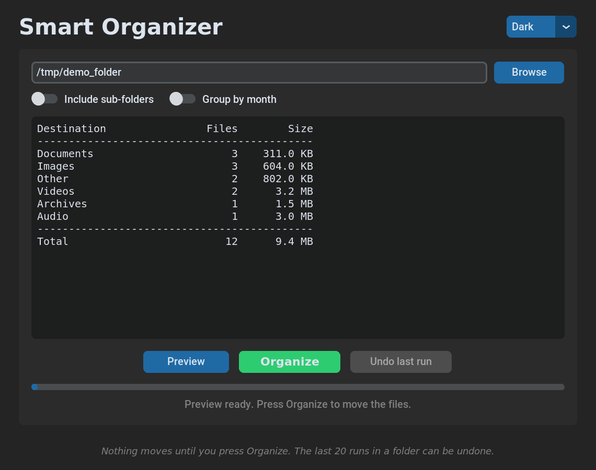
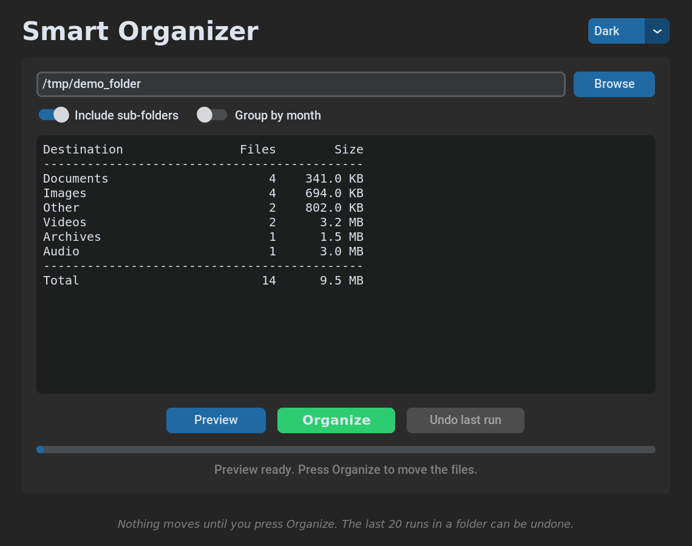
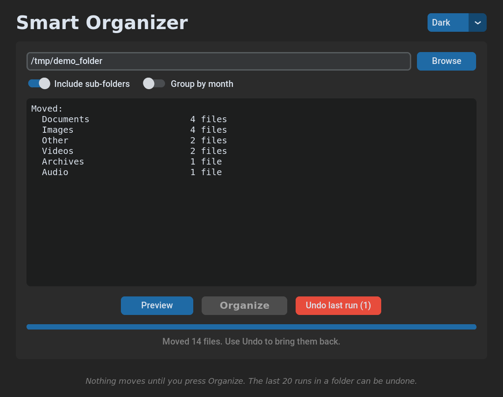
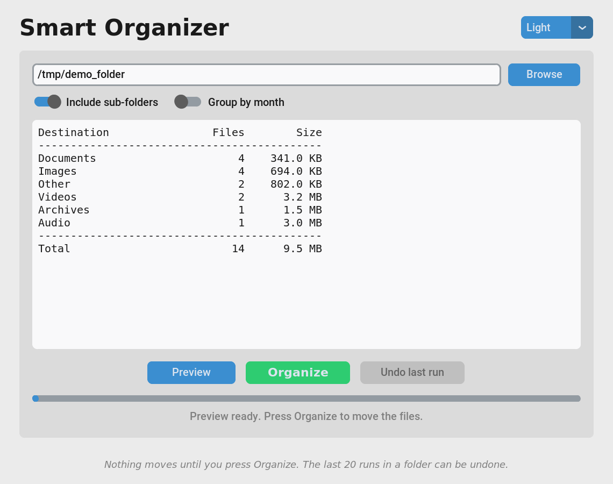

# Smart File Organizer

Sorts the files in a folder into Images, Videos, Audio, Documents, Archives and Other. It shows a preview first, never overwrites, and every run can be undone.



## Features

- **Preview first.** The window and the command line both show how many files and how much data go to each folder before anything moves.
- **Sub-folders (optional).** Include files inside sub-folders. Folders that are already sorted (Images, Videos, ...) and hidden folders are left alone.
- **Group by month (optional).** `Images/2026-11/photo.jpg`, using the file's modified date.
- **Symbolic links are ignored** (never followed, never moved).
- **Safe moves.** A name clash becomes `name_1.ext`; existing files are never overwritten. A file that is locked or not allowed to move is skipped and listed, and the rest still move.
- **Undo, several levels deep.** The last 20 runs are saved in `.organizer_history.json` in the organized folder. Undo also removes folders it emptied.
- **Window with a progress bar** (CustomTkinter, dark and light). Organizing runs in a background thread so the window stays responsive.
- **Command line** with options for scripts (below).

| With sub-folders | After organizing | Light theme |
|---|---|---|
|  |  |  |

## Run

```bash
pip install -r requirements.txt
python gui_main.py                       # desktop window
python main.py ~/Downloads --dry-run     # preview only
python main.py ~/Downloads -r --by-date  # sub-folders + month folders, asks to confirm
python main.py ~/Downloads -y            # no confirmation
python main.py ~/Downloads --undo        # undo the last run
```

## Tests

```bash
python -m pytest -q tests
```

19 tests. Besides the basics (scan, plan, move, sub-folders, month folders, size summary, command line), they check what happens when things go wrong:

- Undo never overwrites a new file that now sits at the old path; the organized file stays safe in its category folder.
- Undo keeps edits made to a file after it was moved, skips files you deleted, and does nothing (no crash) on a corrupt history file.
- Symbolic links and linked folders are never followed or moved.
- Running twice changes nothing the second time and records no empty run.
- A file that cannot be moved (read-only folder) is reported, leaves no stray copy, and the other files still move; undo then covers only what moved.

The window was also driven end to end on a virtual display (preview, sub-folders, month view, organize, undo, light theme) by a hand-run script, not part of pytest.

Demo video: [docs/demo.mp4](docs/demo.mp4) (23 s screen recording of the real window).

_Screenshots and video are real captures of the window (CustomTkinter on Linux, run on a virtual display at 1.5x scale, no resizing). Windows and macOS were not checked._

## Limits

- Sorts by file extension only, not by content. Categories are fixed in `core/organizer.py`; there is no config file yet.
- Month folders use the modified time, which can differ from the date a photo was taken.
- Undo only restores files that are still where the tool put them (skipped otherwise), and only the last 20 runs per folder are kept.
- `gui_main.exe` in the repository is an older build and was not rebuilt for this version.
- The window was checked on Linux only, not Windows or macOS.
